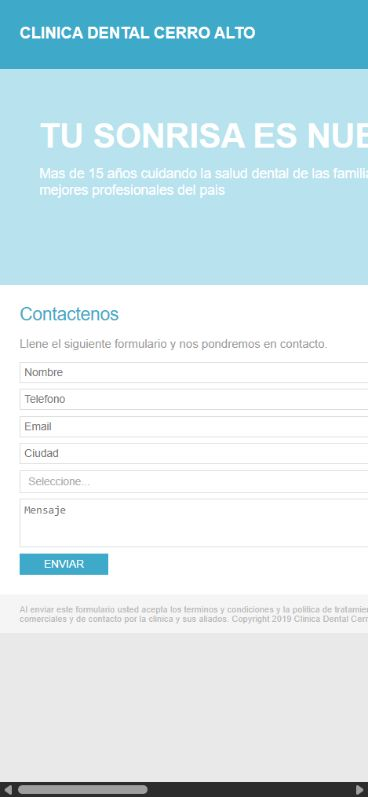
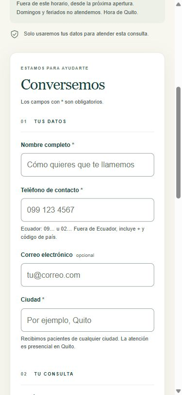
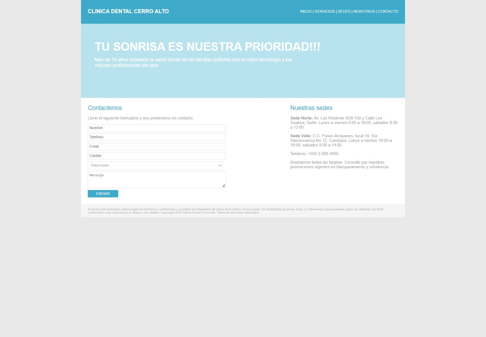
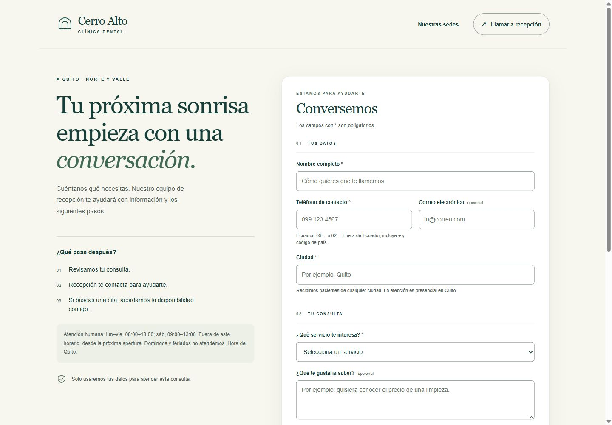

# Contacto · Clínica Dental Cerro Alto

Rediseño del formulario de contacto para reducir datos inválidos y facilitar el envío desde el celular. HTML, CSS y JavaScript sin dependencias de ejecución. Clínica ficticia de la prueba técnica INVERS.

## Verlo localmente

Desde esta carpeta:

```bash
python -m http.server 8766 --bind 127.0.0.1
```

Abre http://127.0.0.1:8766. Se usa un servidor estático porque el JavaScript carga módulos ES; no abrir directamente con `file://`. No requiere instalar paquetes, fuentes ni recursos externos.

`config.js` conserva `WEBHOOK_URL = ""`: **es una demostración, no se envía ningún dato**. El aviso aparece antes del botón y al completar una prueba válida. Se puede probar con datos ficticios; nunca se anuncia que la clínica recibió un lead en este modo.

## Problemas encontrados y cambios

| Problema original | Cambio y motivo |
|---|---|
| Contenedor fijo de 960 px y controles de 400 px: desplazamiento horizontal a 375 px. | Diseño de una columna en celular, ancho flexible, controles de al menos 48 px y texto de entrada de 16 px. En escritorio, introducción y formulario comparten la pantalla. Un enlace móvil lleva directo al formulario. |
| Placeholders sin etiquetas; botón de envío hecho con un `div`; foco eliminado. | Etiquetas siempre visibles, `button type=submit`, envío por teclado, foco visible, enlace para saltar al formulario, secciones semánticas y ayudas asociadas a cada campo. |
| Se enviaban campos vacíos, correos incorrectos y teléfonos sin normalizar. | Validación antes de enviar, errores específicos junto al campo y resumen enlazado con foco. Nombre, teléfono, ciudad, servicio y consentimiento obligatorios; correo y mensaje opcionales. |
| Consentimiento implícito, amplio y para aliados. | Casilla sin marcar para gestionar únicamente esta consulta y contactar al interesado; explica revocación por el correo oficial. No autoriza publicidad ni cesión a aliados. |
| El `fetch` no se esperaba: siempre decía «Enviado» y borraba los datos. | Solo se confirma recepción tras un HTTP 2xx; durante el envío se bloquea el doble clic. Ante error HTTP, red o timeout, los datos permanecen y se permite reintentar. |
| El modo de prueba escribía información personal en consola. | Modo demo explícito, sin red y sin volcar el evento ni datos personales a consola, URL o almacenamiento del navegador. |
| Promesas vagas y afirmaciones no respaldadas sobre la clínica. | Próximos pasos claros, horario de atención humana y sedes según la Ficha del negocio; no se inventa plazo exacto de respuesta, trayectoria, garantías clínicas ni descuentos. Enviar no confirma una cita. |

## Antes y después

Capturas de las vistas de celular y escritorio, con el mismo ancho en cada comparación. La captura móvil del rediseño se centra en los campos del formulario. El original conserva su desbordamiento de 960 px para mostrar el problema, sin encogerlo artificialmente.

### Celular · 375 px de ancho

| Antes | Después |
|---|---|
|  |  |

### Escritorio · 1440 px de ancho

| Antes | Después |
|---|---|
|  |  |

## Validación y contrato

El teléfono se entrega en formato E.164. Acepta las formas ecuatorianas `0991234567`, `+593991234567`, `00593991234567` y `593991234567`; también fijos locales como `020004400`. Internacionales requieren prefijo de país explícito, por ejemplo `+14155550123` o `00442079460123`. No se adivina el país de un número extranjero sin prefijo.

La comprobación es **de formato**: no verifica existencia, operador ni identidad del titular. El correo vacío es válido; si se completa se comprueba sintaxis. Solo se recortan espacios exteriores, nunca se elimina un espacio interior para convertir una entrada incorrecta en válida. El servicio debe ser una de las siete opciones originales. El mensaje libre admite hasta 1000 caracteres y pide no incluir datos sensibles.

Cada envío válido conserva exactamente este esquema, con las mismas claves del conector:

```json
{
  "event_id": "evt_web_<uuid>",
  "event_type": "lead.created",
  "created_at": "<fecha ISO 8601 UTC>",
  "source": {
    "platform": "web",
    "campaign": null,
    "form_id": "frm_web_contacto"
  },
  "lead": {
    "full_name": "<nombre>",
    "phone": "<E.164>",
    "email": "",
    "city": "<ciudad>",
    "service_interest": "<opción original>",
    "message": ""
  }
}
```

La casilla de consentimiento es una condición de la interfaz y no agrega campos al evento. No se solicita cédula, tarjeta ni información clínica para esta consulta inicial. El formulario no utiliza analítica ni almacenamiento persistente de sus entradas; los valores permanecen únicamente en la página hasta iniciar otra consulta o cerrarla. El navegador puede ofrecer su autocompletado habitual.

## Conexión opcional a un webhook

**No está conectado al sistema de la Parte A ni modifica su entrega congelada.** Para una integración posterior, configura una URL receptora HTTPS en `config.js`:

```js
var WEBHOOK_URL = "https://tu-sistema.example.com/webhook";
```

El receptor tiene que admitir `source.platform = "web"`, `source.campaign = null` y el preflight CORS de JSON si está en otro origen. La página espera un 2xx; no interpreta el cuerpo de respuesta ni imprime posibles datos del servidor. Se omiten cookies y referrer. El límite de espera es de 12 segundos.

Un error no limpia ni modifica los datos. El mismo contenido validado reutiliza `event_id` y `created_at` en el reintento; editar el contenido genera un evento nuevo. La protección dura mientras la página está abierta: después de recargar no se conserva identidad. Un timeout puede ocurrir aunque el servidor haya recibido el evento, por eso **el receptor debe deduplicar por `event_id`** antes de crear el lead o avisar a recepción.

Para producción también es necesario validar en servidor, controlar abuso, restringir CORS y registrar la evidencia de consentimiento (fecha y versión del texto) por un mecanismo acordado del lado servidor, sin alterar silenciosamente este contrato. La validación del cliente se puede eludir y no sustituye esas responsabilidades. El consentimiento de esta demo no se registra fuera de la página.

## Pruebas

Con Node.js 20 o superior, sin `npm install`:

```bash
node --test tests/formulario.test.mjs
```

12 pruebas cubren equivalencias de teléfonos, número internacional explícito, correos opcionales e inválidos, campos y autorización obligatorios, límites y catálogo, contrato exacto, demo sin red, HTTP fallido, doble envío, cambios de identidad, timeout y error de red con reintento. Los datos utilizados son ficticios.

Para la comprobación manual: abrir a 375 px y escritorio, recorrer con Tab y Shift+Tab, enviar vacío y corregir desde los enlaces del resumen; probar correo inválido, teléfono local/internacional y demo válida. Comprobar que no hay desplazamiento horizontal ni confirmación falsa de cita o envío real. Las capturas documentan la presentación; las pruebas de entrega usan un `fetch` inyectado y no llaman a un servicio real.

Comprobación realizada en navegador: marco de 375 px de ancho (360 px de contenido más la barra nativa), sin desbordamiento horizontal; vista de escritorio de 1440 px. Se probó envío vacío, foco en el resumen, Tab desde nombre a teléfono, correo inválido con explicación y envío válido con correo vacío. La confirmación final dice explícitamente que es una prueba y que no se envió la consulta. Los archivos del marco de prueba son copias idénticas del formulario y no forman parte del producto. Captura adicional: [errores en móvil](screenshots/errores-movil.png).

## Archivos

- `index.html`: estructura, contenido, etiquetas y consentimiento.
- `styles.css`: diseño adaptable, contraste y foco.
- `script.js`: interacción, errores y estados de envío.
- `validation.mjs`: normalización, validación, evento y entrega con reintentos.
- `config.js`: URL vacía para demostración.
- `tests/formulario.test.mjs`: pruebas sin dependencias.
- `screenshots/`: antes y después en celular y escritorio.
